# Get started

Within the `tidyverse` heatmaps can be generated via
`ggplot2::geom_tile()` but is sometimes hard to reach the versatility
and beauty of a genuine heatmap function. `tidyheatmaps` provides a
tidyverse-style interface to the powerful
[pheatmap](https://github.com/raivokolde/pheatmap) package and enables
the generation of complex heatmaps from tidy data with minimal code.

``` r
library(tidyverse)
library(tidyheatmaps)
```

## Data requirements

[`tidyheatmap()`](https://jbengler.github.io/tidyheatmaps/reference/tidyheatmap.md)
requires tidy data in long format, see
[tidyverse](https://tidyr.tidyverse.org/index.html).

As an example we will use the gene expression data set `data_exprs`. In
the tidyverse lingo the columns of a data frame are called *variables*.
The variable `expression` contains the numeric values to be color-coded
in the heatmap. Furthermore we will use the variables `sample` for
heatmap columns and `external_gene_name` for heatmap rows.

``` r
glimpse(data_exprs)
#> Rows: 800
#> Columns: 9
#> $ ensembl_gene_id    <chr> "ENSMUSG00000033576", "ENSMUSG00000033576", "ENSMUS…
#> $ external_gene_name <chr> "Apol6", "Apol6", "Apol6", "Apol6", "Apol6", "Apol6…
#> $ sample             <chr> "Hin_1", "Hin_2", "Hin_3", "Hin_4", "Hin_5", "Ein_1…
#> $ expression         <dbl> 2.203755, 2.203755, 2.660558, 2.649534, 3.442740, 5…
#> $ group              <chr> "Hin", "Hin", "Hin", "Hin", "Hin", "Ein", "Ein", "E…
#> $ sample_type        <chr> "input", "input", "input", "input", "input", "input…
#> $ condition          <chr> "healthy", "healthy", "healthy", "healthy", "health…
#> $ is_immune_gene     <chr> "no", "no", "no", "no", "no", "no", "no", "no", "no…
#> $ direction          <chr> "up", "up", "up", "up", "up", "up", "up", "up", "up…
```

## Basic usage

The basic layout of the heatmap relies on the parameters `rows`,
`columns` and `values`. You can think of them like aesthetics in
`ggplot2::ggplot()`, similar to something like
`aes(x = columns, y = rows, fill = values)`.

``` r
tidyheatmap(data_exprs,
            rows = external_gene_name,
            columns = sample,
            values = expression
)
```

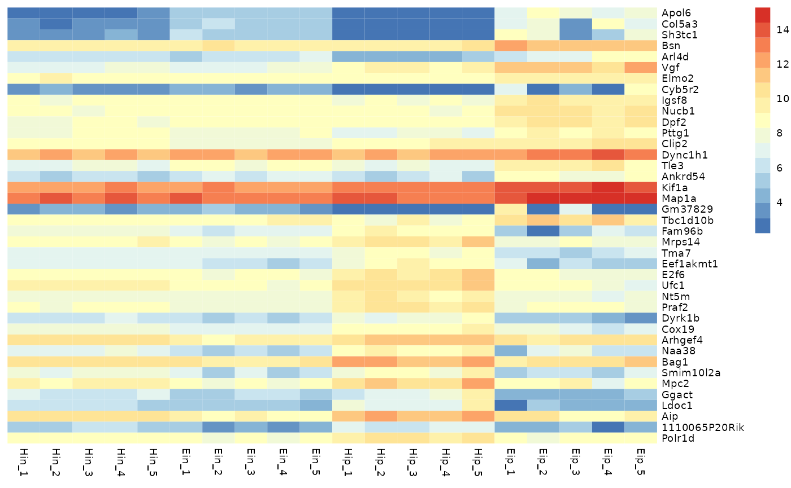

## Data scaling

With the parameter `scale` you can activate data scaling for `"row"` or
`"column"`. By default data scaling is turned off `scale = "none"`.

``` r
tidyheatmap(data_exprs,
            rows = external_gene_name,
            columns = sample,
            values = expression,
            scale = "row"
)
```

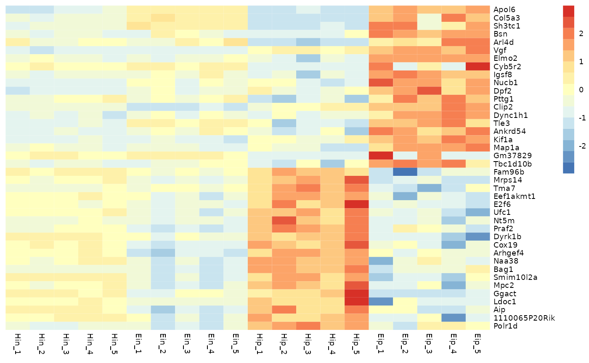

## Ordering

Rows and columns in the heatmap will appear in the same order as in the
tidy data frame used as input. For example, to order rows and columns
alphabetically, just use the
[`dplyr::arrange()`](https://dplyr.tidyverse.org/reference/arrange.html).

``` r
data_exprs %>% 
  arrange(external_gene_name, sample) %>% 
  tidyheatmap(rows = external_gene_name,
              columns = sample,
              values = expression,
              scale = "row"
  )
```

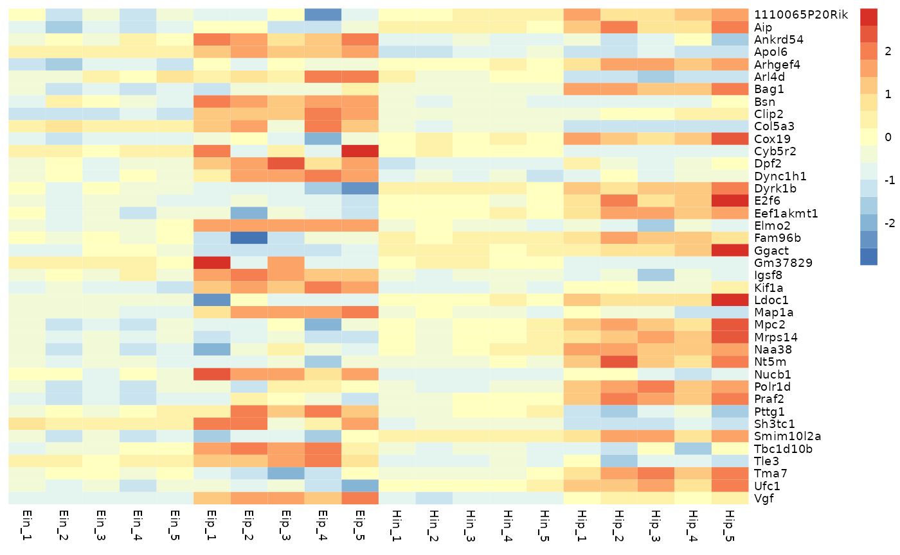

## Color legend

You can customize the number of colors `color_legend_n` in the color
legend. The default is *15*.

``` r
tidyheatmap(data_exprs,
            rows = external_gene_name,
            columns = sample,
            values = expression,
            scale = "row",
            color_legend_n = 5
)
```

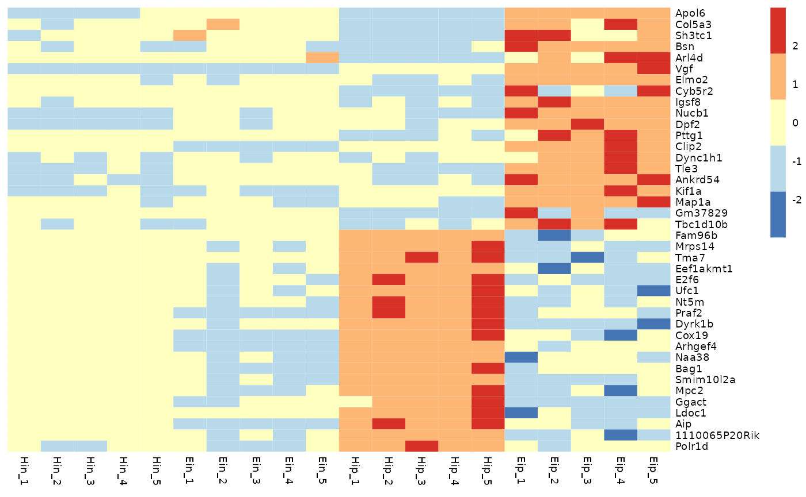

You can also define the minimum and maximum values of the color legend.
Values smaller then the `color_legend_min` will have the lowest color,
values bigger than the `color_legend_max` will get the highest color.

``` r
tidyheatmap(data_exprs,
            rows = external_gene_name,
            columns = sample,
            values = expression,
            scale = "row",
            color_legend_min = -1,
            color_legend_max = 1
)
```

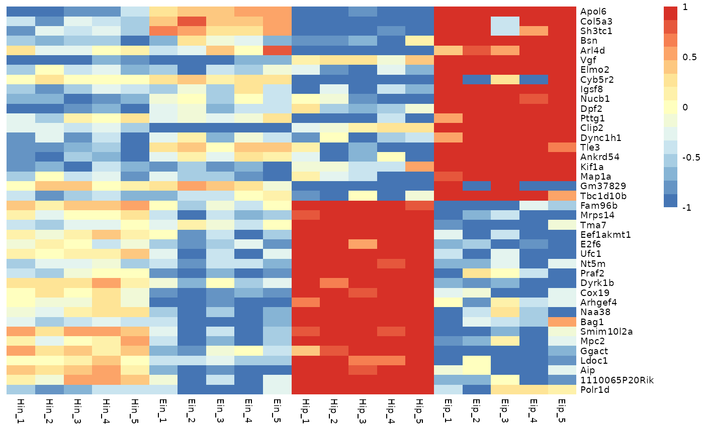

Of course, you can also change the `colors` themselves. The number of
`colors` you provide does not have to match `color_legend_n`. The color
legend is automatically adjusted to have `color_legend_n` colors (the
default is *15*).

``` r
tidyheatmap(data_exprs,
            rows = external_gene_name,
            columns = sample,
            values = expression,
            scale = "row",
            colors = c("#145afc","#ffffff","#ee4445")
)
```

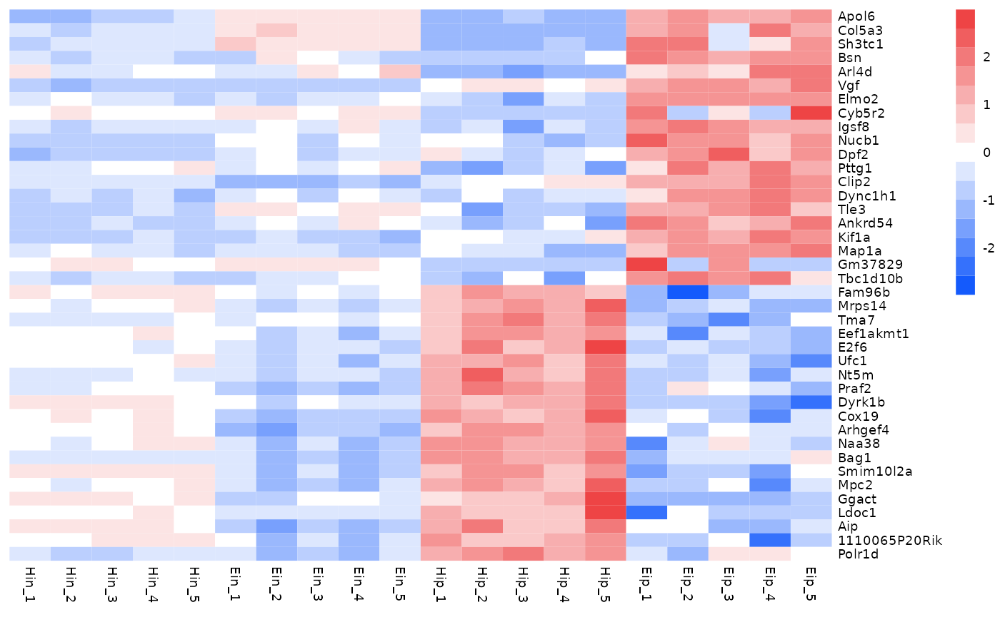

## Annotations

Annotations can be added for both `rows` and `columns` via
`annotation_row` and `annotation_col`, respectively. Just specify the
corresponding variables in the tidy data frame. If you want more then
one variable for annotation just combine them by `c(var1, var2, var3)`.

``` r
tidyheatmap(data_exprs,
            rows = external_gene_name,
            columns = sample,
            values = expression,
            scale = "row",
            annotation_col = c(sample_type, condition, group),
            annotation_row = c(is_immune_gene, direction)
)
```

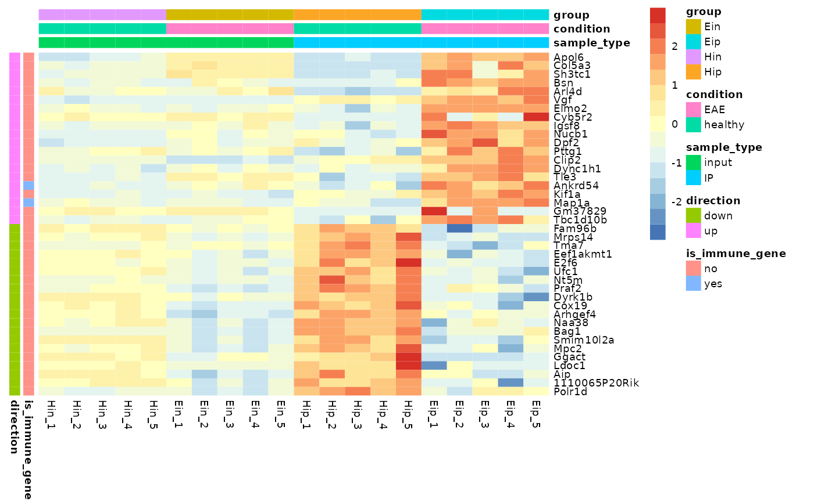

### Customize annotations colors

You can provide a list of named vectors to take control over the
annotations colors `annotation_colors`.

``` r
ann_colors <- list(
  condition = c(EAE = "#BD79B4", healthy = "#F5CEF2"),
  group = c(Ein = "#C14236", Eip = "#E28946", Hin = "#4978AB", Hip = "#98BB85"),
  sample_type = c(input = "#BDBDBD", IP = "#7D7D7D"),
  direction = c(down = "#5071DC", up = "#C34B6B"),
  is_immune_gene = c(yes = "#B69340", no = "#FFFFFF")
)

tidyheatmap(data_exprs,
            rows = external_gene_name,
            columns = sample,
            values = expression,
            scale = "row",
            annotation_col = c(sample_type, condition, group),
            annotation_row = c(is_immune_gene, direction),
            annotation_colors = ann_colors
)
```

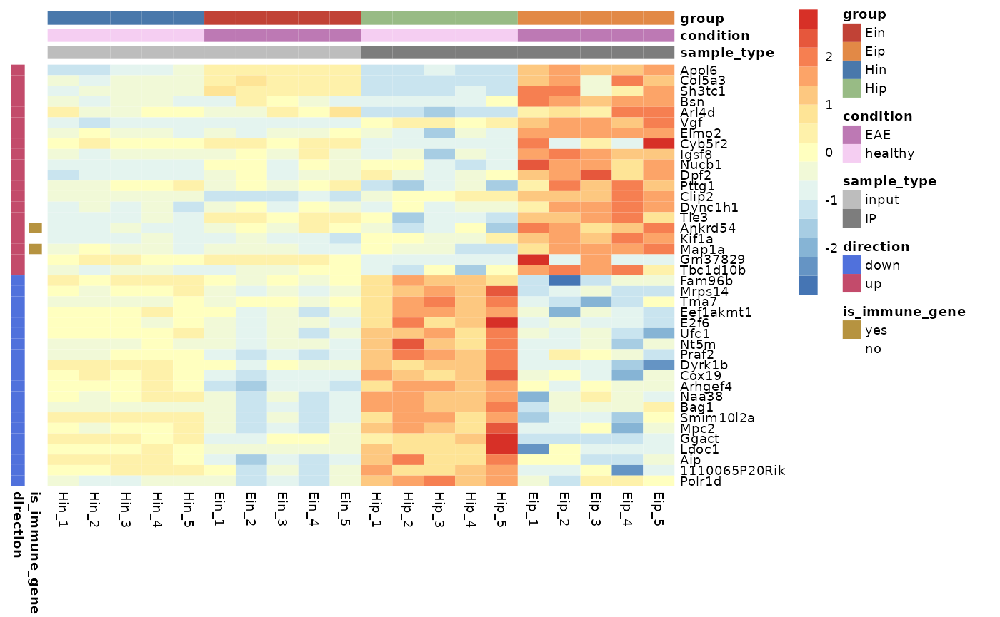

## Gaps

Gaps can be added by specifying data frame variables that should be used
to generate the gaps. Only one variable can be chosen for each
`gaps_row` and `gaps_col`.

``` r
tidyheatmap(data_exprs,
            rows = external_gene_name,
            columns = sample,
            values = expression,
            scale = "row",
            annotation_col = c(sample_type, condition, group),
            annotation_row = c(is_immune_gene, direction),
            annotation_colors = ann_colors,
            gaps_row = direction,
            gaps_col = group
)
```

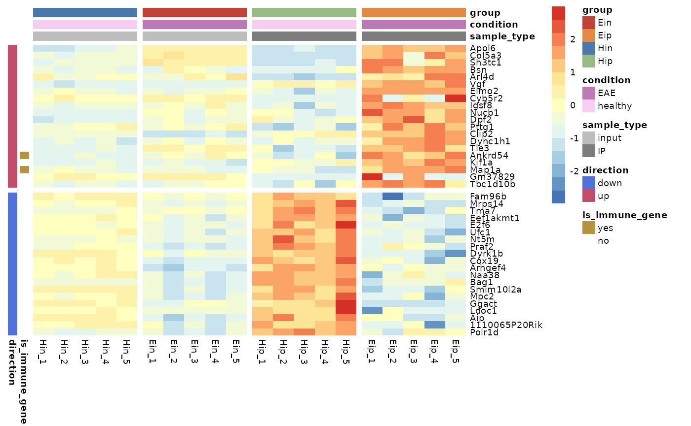

## Cell dimensions

You can provide absolute cell dimensions (in points) via the `cellwidth`
and `cellheight` parameters.

``` r
tidyheatmap(data_exprs,
            rows = external_gene_name,
            columns = sample,
            values = expression,
            scale = "row",
            annotation_col = c(sample_type, condition, group),
            annotation_row = c(is_immune_gene, direction),
            annotation_colors = ann_colors,
            gaps_row = direction,
            gaps_col = group,
            cellwidth = 7,
            cellheight = 7
)
```

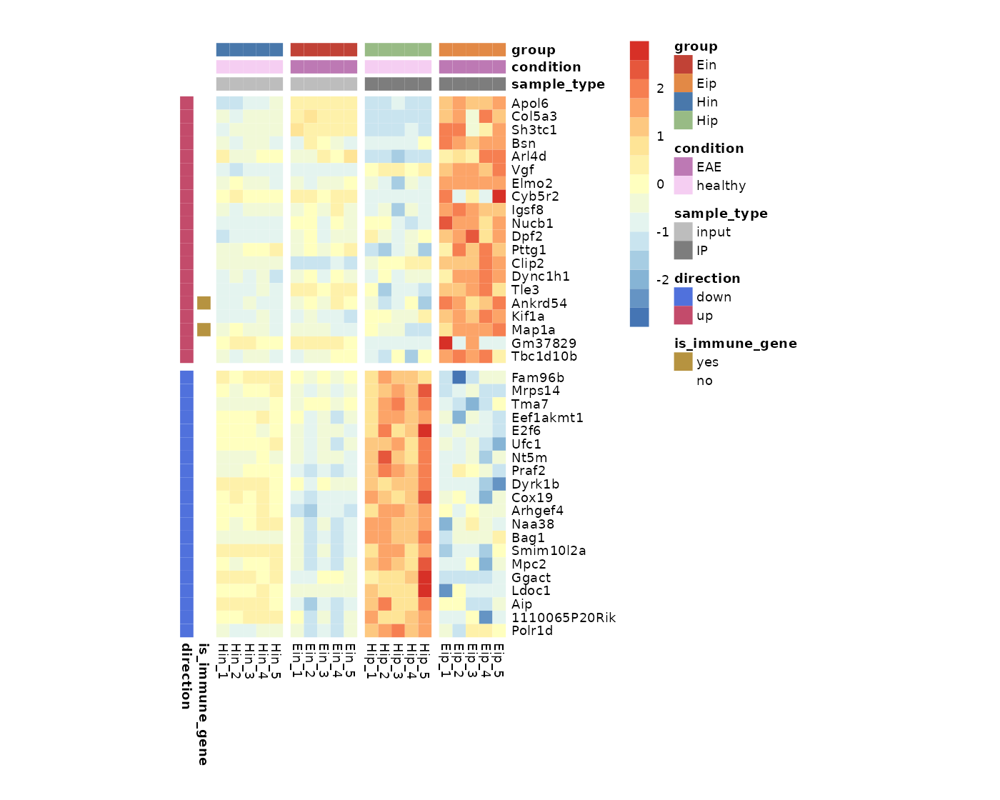

## Show selected labels

To highlight a selection of row or column labels while hiding the rest,
you can use `show_selected_row_labels` or `show_selected_col_labels`,
respectively.

``` r
tidyheatmap(data_exprs,
            rows = external_gene_name,
            columns = sample,
            values = expression,
            scale = "row",
            annotation_col = c(sample_type, condition, group),
            annotation_row = c(is_immune_gene, direction),
            annotation_colors = ann_colors,
            gaps_row = direction,
            gaps_col = group,
            cellwidth = 7,
            cellheight = 7,
            show_selected_row_labels = c("Apol6","Bsn","Vgf","Fam96b","Bag1","Aip"),
)
```

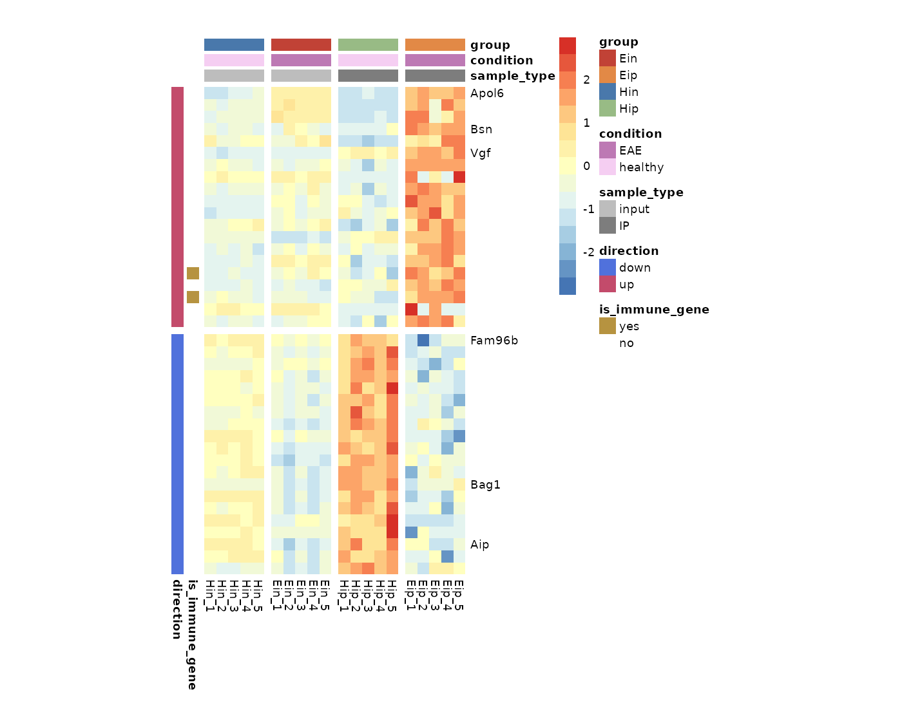

## Write to file

You can use the parameter `filename` to write the heatmap to file.

``` r
tidyheatmap(data_exprs,
            rows = external_gene_name,
            columns = sample,
            values = expression,
            filename = "my_heatmap.pdf"
)
```

## More features

[pheatmap](https://github.com/raivokolde/pheatmap) provides even more
features like clustering, dendrograms, text within cells, *et cetera*.
Additional available parameters can be found in the documentation of
[`tidyheatmap()`](https://jbengler.github.io/tidyheatmaps/reference/tidyheatmap.md).

``` r
tidyheatmap(data_exprs,
            rows = external_gene_name,
            columns = sample,
            values = expression,
            scale = "row",
            cluster_rows = TRUE,
            cluster_cols = TRUE,
            display_numbers = TRUE
)
```

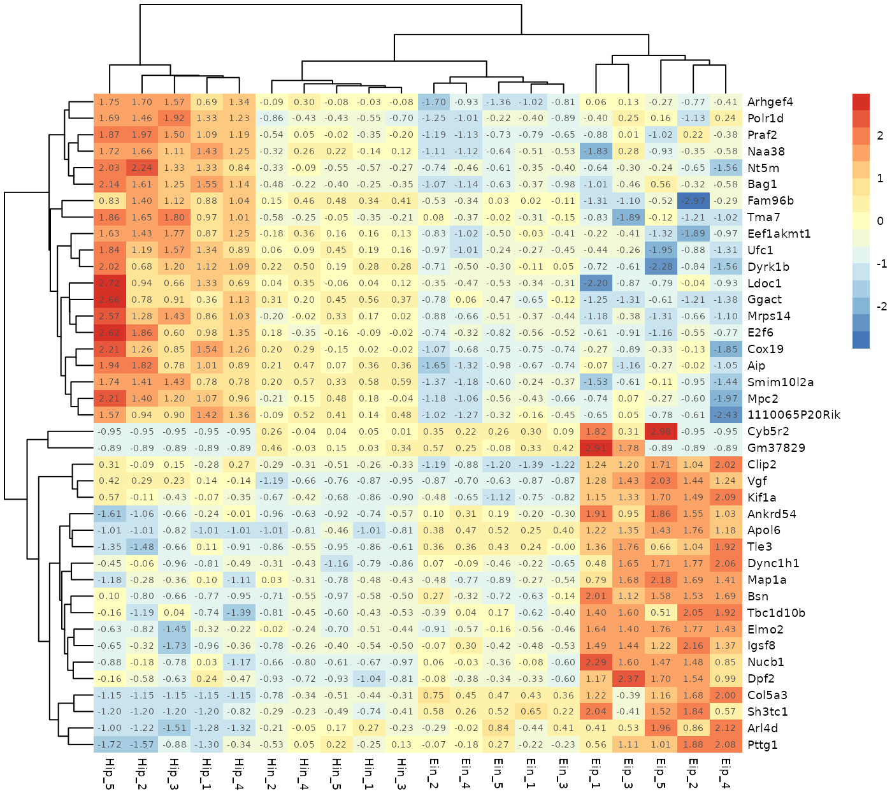
